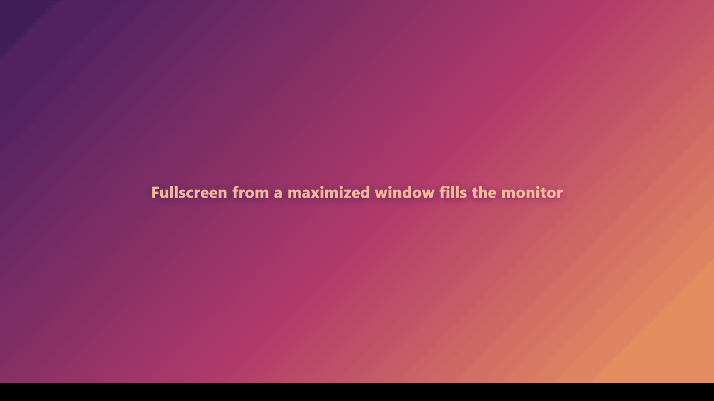
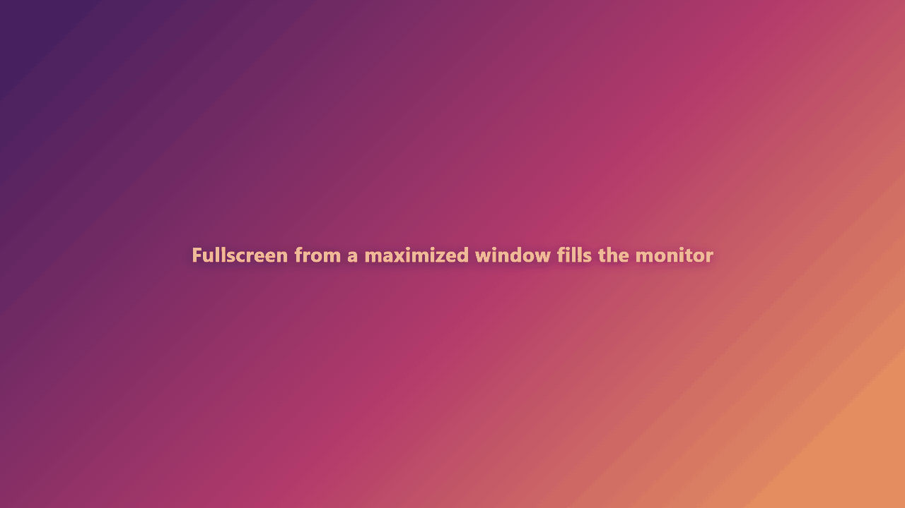
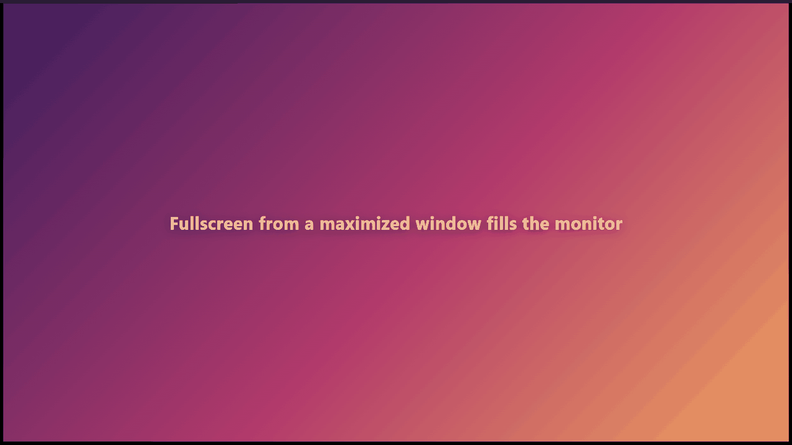

# Fullscreen from a maximized window

These captures show a synthetic local verification page, not a streaming session. Win32 `PrintWindow` with `PW_RENDERFULLCONTENT` captured only the verification window.

## Before



The maximized window enters fullscreen with its client area still sized to the monitor work area:

```text
monitor: 1920x1080
work area: 1920x1032
fullscreen window: 1920x1080 at 0,0
fullscreen client: 1920x1032
fillsMonitor: false
```

The bottom 48 px stay black, so the player never covers the taskbar strip. Leaving fullscreen also leaves the window stuck at `1920x1080 at 0,0` while still reporting `maximized: true`.

## After



The window is restored before entering fullscreen and maximized again on exit:

```text
fullscreen client: 1920x1080
fillsMonitor: true
after exit: maximized, 1936x1048 at -8,-8 (the normal maximized frame)
```



## Checks

```bash
cargo build --manifest-path src-tauri/Cargo.toml
cargo test --manifest-path src-tauri/Cargo.toml
cargo clippy --manifest-path src-tauri/Cargo.toml -- -D warnings
node --test scripts/release-contract.test.mjs
```

All passed. Rust ran nine tests; the release contract ran one test.

The fullscreen scenarios (video and F11, from restored and maximized windows, entered and exited twice each) were also run headlessly against the debug build. The maximized cases fail on the unfixed build (`fillsMonitor: false`) and pass on this branch (`fillsMonitor: true`, maximized state restored on exit).

The full `npm test` suite was not run because it moves the real mouse and the user's app was active and maximized on the same desktop. The fullscreen assertions it contains are covered by the headless scenarios above. No live account or streaming data was used.
