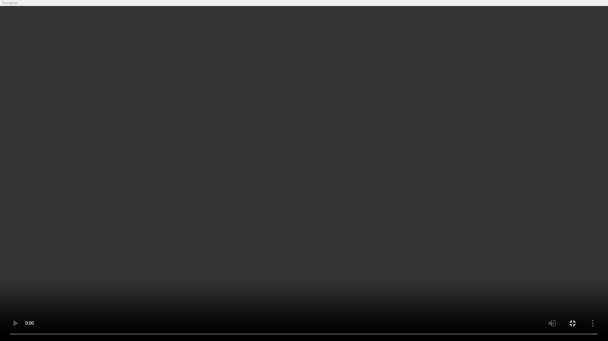
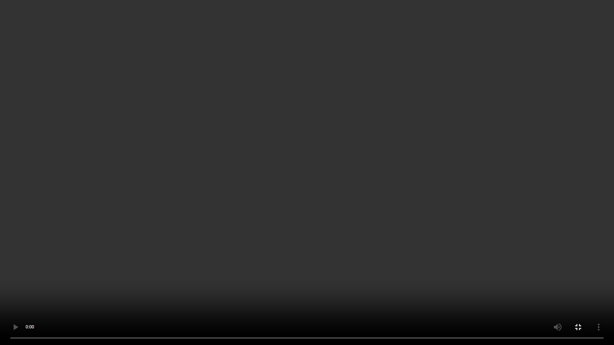
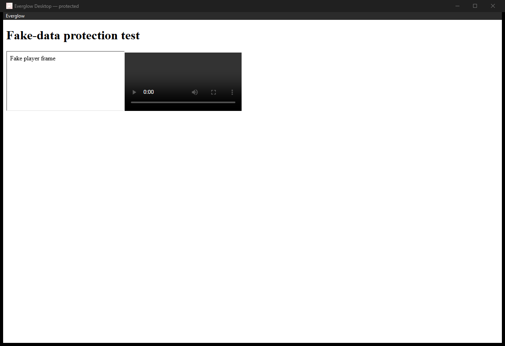

# Fullscreen regression proof

These captures show the fake local verification page, not a streaming session. The video has no source. Win32 `PrintWindow` with `PW_RENDERFULLCONTENT` captured only the verification window, including its native menu.

## Before



The pre-existing local 0.3.1 release executable fails the new native-window assertion:

```text
Video fullscreen must hide the native menu and fill the monitor
actual:   { menuVisible: true,  fillsMonitor: false }
expected: { menuVisible: false, fillsMonitor: true  }
```

## After





The debug executable built from this branch passes repeated video and F11 entry/exit checks. The native client fills the monitor in fullscreen, F11 still exits with the menu hidden, and the restored menu can pause/resume ad blocking across reloads. The full desktop suite passed three consecutive runs before screenshot collection and passed again during capture.

## Checks

```bash
CARGO_TARGET_DIR='C:/APPLICATIONS/Everglow-Desktop/src-tauri/target' cargo build --manifest-path src-tauri/Cargo.toml --locked
DESKTOP_EXE='C:/APPLICATIONS/Everglow-Desktop/src-tauri/target/debug/everglow-desktop.exe' npm test
CARGO_TARGET_DIR='C:/APPLICATIONS/Everglow-Desktop/src-tauri/target' cargo test --manifest-path src-tauri/Cargo.toml --locked
CARGO_TARGET_DIR='C:/APPLICATIONS/Everglow-Desktop/src-tauri/target' cargo clippy --manifest-path src-tauri/Cargo.toml --locked -- -D warnings
node --test scripts/release-contract.test.mjs
```

All passed. Rust ran five tests; the release contract ran one test. `evidence/native-verification.json` records the desktop checks.

One earlier post-fix run failed to locate the native menu during the second adblock toggle. The unchanged code passed the next run and three consecutive reruns. The cause of that intermittent test failure is unproven. The fullscreen assertions passed in that run.

Live authenticated playback, cross-origin player fullscreen, Escape-key exit, multiple monitors and non-default DPI were not checked. No release was built for publication. CI validates the isolated installer separately.
